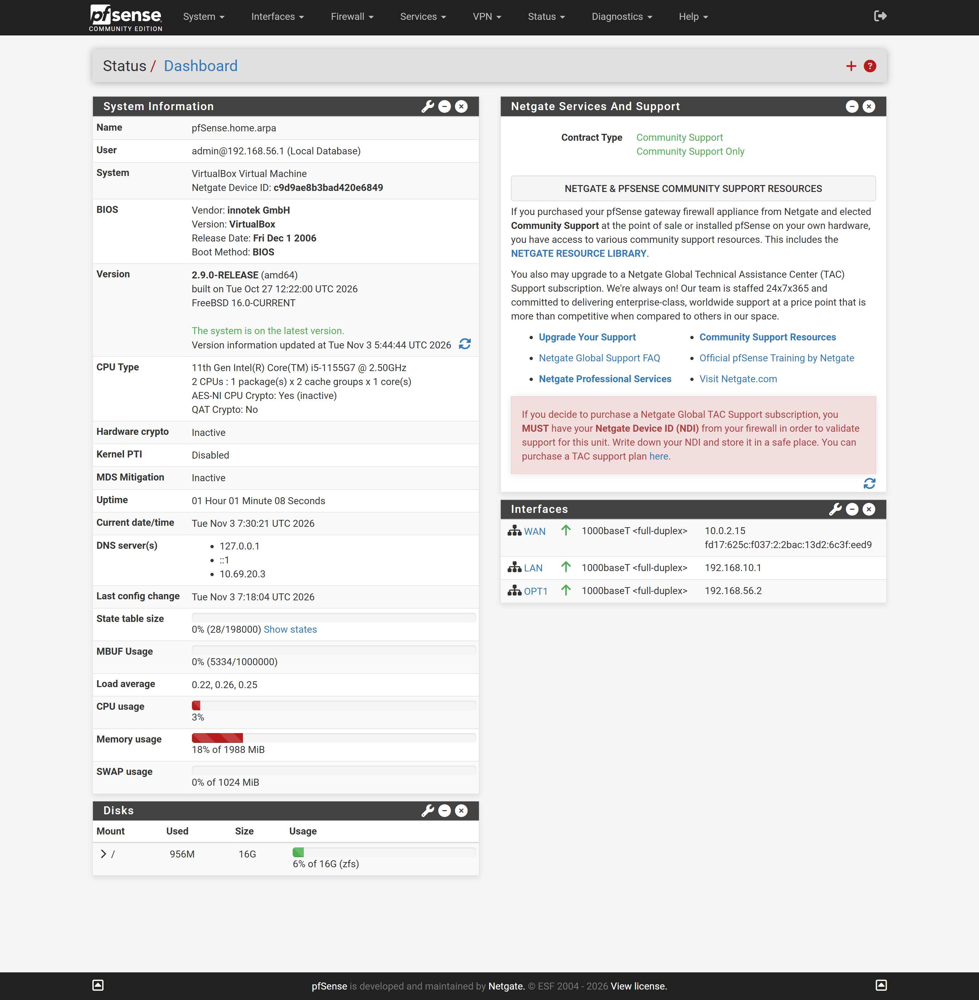
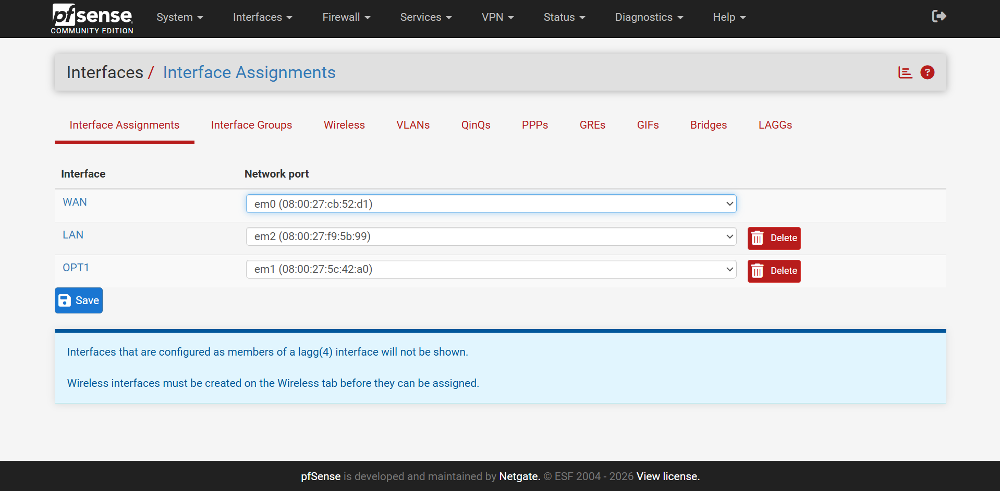
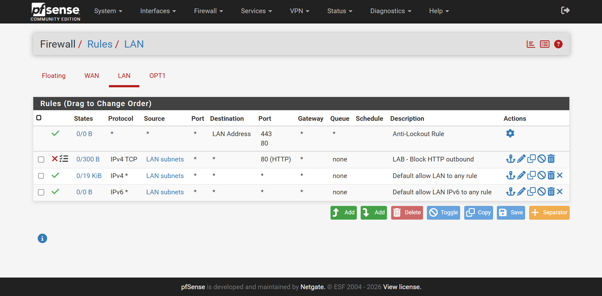
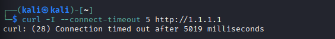
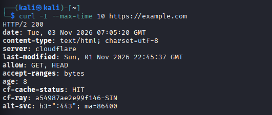
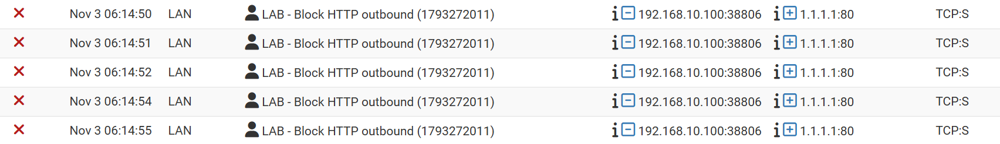

# Firewall dan Network Monitoring Lab

## Project Overview

Proyek ini berfokus pada konfigurasi firewall dan monitoring jaringan menggunakan **pfSense** dan **Kali Linux** dalam lingkungan virtualisasi Oracle VirtualBox.

Tujuan proyek ini adalah menerapkan aturan firewall untuk mengontrol lalu lintas jaringan, menguji konektivitas HTTP dan HTTPS, serta memantau aktivitas jaringan melalui firewall logs.

Melalui proyek ini, dilakukan konfigurasi interface jaringan, DHCP server, firewall rules, serta pengujian dan analisis lalu lintas jaringan untuk memahami penerapan dasar network security.

## Tools and Environment

| Komponen | Keterangan |
|---|---|
| Host OS | Windows 11 |
| Virtualization | Oracle VirtualBox |
| Firewall | pfSense CE |
| Testing Machine | Kali Linux 2025.3 |
| Network Type | NAT, Host-Only, Internal Network |

## Network Topology

Topologi jaringan yang digunakan:

```text
                  Internet
                     |
                 NAT (WAN)
                     |
               +-----------+
               |  pfSense  |
               | Firewall  |
               +-----------+
                  |       |
             LAN em2   OPT1 em1
           192.168.10.1 192.168.56.2
                  |       |
             Internal   Host-Only
              Network    Network
                  |       |
             Kali Linux  Windows 11
           192.168.10.100 192.168.56.1
```

### IP Address Configuration

| Perangkat | Interface | IP Address |
|---|---|---|
| pfSense | WAN (em0) | 10.0.2.15 |
| pfSense | LAN (em2) | 192.168.10.1/24 |
| pfSense | OPT1 (em1) | 192.168.56.2/24 |
| Windows 11 | Host-Only | 192.168.56.1/24 |
| Kali Linux | LAN | 192.168.10.100/24 |

Kali Linux memperoleh IP address melalui DHCP server yang berjalan pada interface LAN pfSense.

## Configuration Steps

### A. Virtual Machine and Network Setup

1. Membuat virtual machine pfSense di Oracle VirtualBox.
2. Mengatur Adapter 1 sebagai NAT untuk koneksi WAN.
3. Mengatur Adapter 2 sebagai Host-Only untuk akses administrasi dari Windows.
4. Mengatur Adapter 3 sebagai Internal Network dengan nama `P5-LAN`.
5. Membuat virtual machine Kali Linux dan menghubungkannya ke Internal Network `P5-LAN`.
6. Melakukan instalasi pfSense dan konfigurasi interface jaringan.

### B. Interface Configuration

Interface pfSense yang digunakan:

- WAN: `em0`
- LAN: `em2`
- OPT1: `em1`

Konfigurasi alamat IP:

- WAN: `10.0.2.15`
- LAN: `192.168.10.1/24`
- OPT1: `192.168.56.2/24`

Interface OPT1 digunakan untuk menyediakan akses administrasi WebConfigurator pfSense dari Windows 11 melalui jaringan Host-Only.

### C. DHCP Configuration

DHCP server diaktifkan pada interface LAN dengan konfigurasi:

- DHCP Range: `192.168.10.100 – 192.168.10.199`
- Subnet: `192.168.10.0/24`
- Gateway: `192.168.10.1`

Kali Linux berhasil memperoleh IP address `192.168.10.100` melalui DHCP.

### D. Firewall Rule Configuration

Firewall rule dibuat pada interface LAN untuk memblokir koneksi HTTP keluar.

| Parameter | Konfigurasi |
|---|---|
| Action | Block |
| Interface | LAN |
| Address Family | IPv4 |
| Protocol | TCP |
| Source | LAN subnets |
| Destination | Any |
| Destination Port | HTTP (80) |
| Description | LAB - Block HTTP outbound |

Rule ditempatkan di atas aturan default allow LAN agar koneksi HTTP yang sesuai dengan kriteria rule diblokir sebelum mencapai aturan yang mengizinkan lalu lintas lainnya.

Logging diaktifkan pada rule tersebut untuk memudahkan pemantauan aktivitas yang diblokir.

## Testing and Results

Pengujian konektivitas jaringan dilakukan menggunakan terminal Kali Linux.

### A. HTTP Connection Test

Command:

```bash
curl -I --connect-timeout 5 -4 http://1.1.1.1
```

Hasil:

```text
curl: (28) Connection timed out after 5004 milliseconds
```

**Analisis:**

Koneksi HTTP ke alamat `1.1.1.1` mengalami timeout. Firewall log pfSense menunjukkan bahwa paket TCP dari Kali Linux menuju port 80 diblokir oleh rule `LAB - Block HTTP outbound`.

### B. HTTPS Connection Test

Command:

```bash
curl -I --max-time 10 https://example.com
```

Hasil:

```text
HTTP/2 200
```

**Analisis:**

Koneksi HTTPS berhasil mendapatkan respons HTTP/2 200. Hasil ini menunjukkan bahwa koneksi HTTPS melalui port 443 tetap dapat dilakukan.

### C. Firewall Log Monitoring

Monitoring aktivitas firewall dilakukan melalui menu:

`Status → System Logs → Firewall`

Firewall log menunjukkan aktivitas koneksi yang diblokir oleh rule:

`LAB - Block HTTP outbound`

Contoh informasi lalu lintas yang tercatat:

- Source: `192.168.10.100`
- Destination: `1.1.1.1`
- Destination Port: `80`
- Protocol: TCP
- Action: Block

Log tersebut membuktikan bahwa pfSense mendeteksi dan memblokir percobaan koneksi HTTP dari Kali Linux sesuai dengan firewall rule yang telah dibuat.

## Screenshots

### 1. pfSense Dashboard


### 2. Network Configuration


### 3. Firewall Rule LAN


### 4. HTTP Connection Blocked


### 5. HTTPS Connection Allowed


### 6. Firewall Logs


## Conclusion

Berdasarkan konfigurasi dan pengujian yang telah dilakukan, pfSense berhasil diterapkan sebagai firewall untuk mengontrol lalu lintas jaringan antara Kali Linux dan internet.

Firewall rule berhasil memblokir koneksi HTTP melalui TCP port 80, sementara koneksi HTTPS melalui port 443 tetap berhasil. Aktivitas pemblokiran juga dapat diamati melalui Firewall Logs pada pfSense.

Proyek ini memberikan pengalaman langsung dalam konfigurasi interface jaringan, DHCP server, firewall rules, pengujian konektivitas, serta monitoring aktivitas jaringan menggunakan pfSense.

## Project Information

- **Project:** Project 5 — Firewall dan Network Monitoring Lab
- **Tools:** pfSense, Kali Linux, Oracle VirtualBox
- **Platform:** Windows 11
- **Focus:** Firewall Configuration and Network Monitoring
